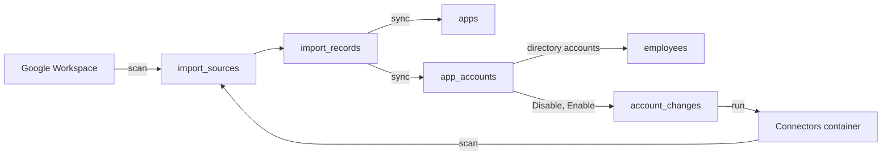

# Data model

The tables broccoli-access uses, what each row means, and an example row from the seeded company, Acme. Each circle builds the tables and changes under its own heading. A table, column or enum value missing here is added to this file first.

Conventions, as in Broccoli:

- Postgres. Ids are `uuidv7()` unless said otherwise; examples shorten them (`emp_ana`).
- Times are `timestamptz`. Enum values are lowercase text with a check constraint, and each value carries its full meaning on its own.
- Keys that connector modules register (connector keys, finding kinds) are checked in code, not by a constraint, so a new module needs no change to a shared table.
- Secrets are stored encrypted with the instance's encryption key.
- Every change to an employee, app, app account or app connection appends a `record_history` row in the same transaction.

## How data flows



1. Each connector adds what it can connect: Google Workspace from the core, every other app from the connectors container. An `app_connections` row holds one connected app.
2. A scan reads one connection: when it is connected, every day, and on "Scan now".
3. The scan writes every account it saw as `import_records`. After a successful scan, a source's records are exactly what it returned this time.
4. The sync updates `apps` and `app_accounts` from the records of every source. The accounts of the directory app create and update `employees`. Nothing in the UI reads `import_records` directly.
5. Disable and Enable write an `account_changes` row, which runs through the connectors container and updates the app account.
6. Flags are computed when read, never stored (see "Computed when read").

## Connectors

Connectors come from two places, and the core sees both in one shape:

- **The core's own module**: Google Workspace, the directory. It exports its definition in code, and one shared contract test checks it.
- **The connectors container**: every other app. The core reads their definitions from `GET /v1/connectors` when it starts and keeps them in memory, never in a table. See the [connector contract](connector-contract.md).

Every connector has:

- **Description**:
  - `key`, such as `google_workspace` or `slack`, plus `version` and `name`;
  - `capabilities`: `list_accounts`, plus `suspend` and `reactivate` for a connector that can change accounts. Google Workspace only lists in circle 2;
  - `runtimes`: where its calls run, in order: `server`, `owner_browser`. Google Workspace runs on the server;
  - the finding kinds it registers, such as `google_directory` and `google_sign_in`;
  - whether its app is the directory: only Google Workspace;
  - its connection fields, each marked secret or not. Secret fields go to `encrypted_secrets`, the others to `settings`;
  - for a container connector, its `notice` and `adminUrl`.
- **Settings check**: a schema for its settings and secrets. A container connector's settings and secrets are opaque to the core.
- **Functions**:
  - `testConnection`: returns what Settings shows, such as the domain, or an error;
  - `listAccounts(cursor)`: one page of accounts in the `import_records` shape, with the next cursor;
  - `runAction`, for a connector that can change accounts: one suspend or reactivate, answered with the account as read afterwards.
- **Errors**: a connector fails with one of these, and never passes on the app's raw response:
  - `authentication_failed`: its token was revoked or expired;
  - `permission_missing`: a scope or an admin right is missing;
  - `rate_limited`: retried before it fails;
  - `app_unavailable`: a timeout or server error, retried before it fails;
  - `unexpected_response`: an answer the connector does not understand;
  - from the connectors container only: `blocked_by_check`, `account_not_found`, `wrong_workspace`, `not_allowed`, `owner_browser_lost`. The [connector contract](connector-contract.md#errors) defines them.

## Words

- **Employee**: someone in the company's directory. The UI calls employees "people"; "user" stays the person who signs in to broccoli-access.
- **App**: an application people use, such as Figma, Slack or Google Workspace itself.
- **App account**: one person's account in one app, whatever source found it.
- **Connector**: what reads, and may change, one app's accounts: the Google Workspace module in the core, or one in the connectors container.
- **Account change**: one Disable or Enable of one app account, from the owner's click to its result.
- **App connection**: one connected app, with the connector's settings and secrets.
- **Directory**: the app whose accounts are the company's employees. In circle 1 it is Google Workspace, and its connector says so in code.
- **Scan**: one read of one app connection.

## Circle 1

### instance (changed)

The one row describing this installation.

- `setup_step`: `connect_google`, `scan`, `select_apps`, `done`.
- Kept: `owner_user_id`, `setup_token_hash`, `setup_expires_at`, `mail_source`, `mail_from`, `encrypted_mail_secret`, `mail_link_origin`.
- Removed: `demo_expires_at`, the `managed_*` columns, `encrypted_instance_credential`, `owner_sign_in_method`, `encrypted_broccoli_ai_token`, `ai_source`, `encrypted_openrouter_key`.
- The owner is the Google admin who consented in setup.

```json
{
  "id": true,
  "owner_user_id": "usr_admin",
  "setup_step": "done",
  "setup_token_hash": null,
  "setup_expires_at": null,
  "mail_source": "smtp_server",
  "mail_from": "access@acme.example",
  "encrypted_mail_secret": "v1:…",
  "mail_link_origin": "https://access.acme.example"
}
```

### user, session, account, verification (unchanged)

Better Auth's tables. Sign-in is with Google only, so each user has one `account` with `provider_id` `google`. It uses the Google app of the Google Workspace connection.

### app_connections (new)

One row per connected app. It replaces Broccoli's `slack_connection`.

- `connector`: the connector module's key: `google_workspace`. Unique, so there is one connection per connector.
- `app_id`: the app this connection reads (Google Workspace).
- `settings`: JSON the connector owns: what it needs and what Settings shows. No secrets.
- `encrypted_secrets`: the connector's secrets as one JSON object, encrypted with the connection's id as associated data, so a secret copied into another row does not decrypt.
- `connected_at`.
- Google Workspace:
  - `settings` holds `googleApp` (`own_google_app`; a later circle adds `broccoli_google_app`), `clientId`, `domain`, `organizationName`, `adminEmail`, `grantedScopes`.
  - The secrets are the client secret and the refresh token.
  - The organisation name is shown in the sidebar. There is no logo; the sidebar shows its initial.
  - The row is written when the admin's consent comes back. Until then, the client ID and secret travel in the encrypted OAuth state.

```json
[
  {
    "id": "con_google",
    "connector": "google_workspace",
    "app_id": "app_google_workspace",
    "settings": {
      "googleApp": "own_google_app",
      "clientId": "123456789012-abc.apps.googleusercontent.com",
      "domain": "acme.example",
      "organizationName": "Acme",
      "adminEmail": "admin@acme.example",
      "grantedScopes": [
        "openid",
        "email",
        "profile",
        "https://www.googleapis.com/auth/admin.directory.user.readonly",
        "https://www.googleapis.com/auth/admin.directory.user.security",
        "https://www.googleapis.com/auth/admin.directory.customer.readonly",
        "https://www.googleapis.com/auth/admin.reports.audit.readonly"
      ]
    },
    "encrypted_secrets": "v1:…",
    "connected_at": "2026-11-20T07:58:00Z"
  }
]
```

### import_sources (changed)

One row per place a scan reads from.

- `kind`: `app_connection`. A later circle adds `file` for CSV uploads.
- `connection_id`: set exactly when `kind` is `app_connection`, and unique.
- `name`: what the UI calls the source, such as the Google domain.
- `status`: `scanning`, `scanned`, `scan_failed`.
- `failure`, set exactly when `scan_failed`, one of the connector errors (see "Connector modules"): `authentication_failed`, `permission_missing`, `rate_limited`, `app_unavailable`, `unexpected_response`. Circle 1 builds only the happy path, but the fakes can return each of them.
- `read_at`: when the last successful scan finished. The UI shows "Scanned today at 08:00".
- Removed: `failure_message`, `mapping_attempt`, `file_id`, `read_by`, `picked_up_by_external_agent_at`, `external_agent_progress`, `original_read_allowed_at`, `original_read_ai_source`.

```json
[
  {
    "id": "src_google",
    "kind": "app_connection",
    "connection_id": "con_google",
    "name": "acme.example",
    "status": "scanned",
    "failure": null,
    "read_at": "2026-11-21T08:00:41Z",
    "created_at": "2026-11-20T07:58:05Z"
  }
]
```

### import_records (changed)

Every account a source saw in its last scan, one row each. `raw` keeps the source's JSON; `values` follow the schema of `type` at `type_version`.

- `type`: `app_account`. Broccoli's `employee` type goes.
- `source_key`: the source's own id for the account, unique within the source. Examples: the Google user id, `<Google user id>:<client id>` for a grant.
- `values`, version 1:
  - `email`, `status` (`active` or `suspended`);
  - `firstName`, `lastName`, `managerEmail`: given by the directory, null elsewhere;
  - `appName`;
  - `appExternalId`: how the source names another app, such as `google:<client id>` for a Google grant. It is null when the account belongs to the connection's own app.
  - `grantedAt`: when the person granted the app access, from the source's log. It is null when the log does not hold the grant or the source has no log.
  - `grantedBefore`: set only when `grantedAt` is null because the grant is older than the log: the earliest moment the log covered at this scan (Google keeps about 6 months). The grant happened before it.
- Kept, unused in circle 1: `photo_url`, `photo_file_id`.

```json
[
  {
    "id": "rec_ana_google",
    "source_id": "src_google",
    "type": "app_account",
    "type_version": 1,
    "source_key": "104857392018374650123",
    "raw": {
      "id": "104857392018374650123",
      "primaryEmail": "ana@acme.example",
      "name": { "givenName": "Ana", "familyName": "Ruiz" },
      "suspended": true,
      "relations": [{ "type": "manager", "value": "david@acme.example" }]
    },
    "values": {
      "email": "ana@acme.example",
      "status": "suspended",
      "firstName": "Ana",
      "lastName": "Ruiz",
      "managerEmail": "david@acme.example",
      "appName": "Google Workspace",
      "appExternalId": null,
      "grantedAt": null,
      "grantedBefore": null
    }
  },
  {
    "id": "rec_ana_figma",
    "source_id": "src_google",
    "type": "app_account",
    "type_version": 1,
    "source_key": "104857392018374650123:871234567890-figma.apps.googleusercontent.com",
    "raw": {
      "clientId": "871234567890-figma.apps.googleusercontent.com",
      "displayText": "Figma",
      "scopes": ["openid", "email", "profile"],
      "userKey": "104857392018374650123"
    },
    "values": {
      "email": "ana@acme.example",
      "status": "active",
      "firstName": null,
      "lastName": null,
      "managerEmail": null,
      "appName": "Figma",
      "appExternalId": "google:871234567890-figma.apps.googleusercontent.com",
      "grantedAt": null,
      "grantedBefore": "2026-05-25T08:00:00Z"
    }
  }
]
```

### employees (changed)

Everyone with an account in the directory app. The table knows nothing about Google or any other app. The sync creates and updates employees from the directory app's accounts, matched by email.

- `manager_id`: the employee whose email the directory names as manager. It replaces `employments`.
- Kept: `first_name`, `last_name`, `email` (unique), `user_id` (the user who signs in as this employee), `avatar_file_id`, `created_at`.
- `avatar_file_id` is used from circle 1. The scan reads a directory person's thumbnail only when its `thumbnailPhotoEtag` changed since the last scan, stores the image in `files` and links it as `avatar_file_id`, with a `record_history` row (`found_by_scan`); a photo removed in Google clears the link. One extra API call per changed photo; very large directories stay out of circle 1.
- Removed: `job_title`, `location_id`, `is_demo`.
- An employee whose directory account disappears stays as they are in circle 1. A later circle handles it.

```json
[
  {
    "id": "emp_ana",
    "first_name": "Ana",
    "last_name": "Ruiz",
    "email": "ana@acme.example",
    "manager_id": "emp_david",
    "user_id": null,
    "avatar_file_id": "file_ana_photo",
    "created_at": "2026-11-20T07:58:20Z"
  },
  {
    "id": "emp_admin",
    "first_name": "Mia",
    "last_name": "Novak",
    "email": "admin@acme.example",
    "manager_id": null,
    "user_id": "usr_admin",
    "avatar_file_id": null,
    "created_at": "2026-11-20T07:58:20Z"
  }
]
```

### apps (new)

Every app a source found, and the connected apps themselves.

- `name`, `domain` (null when unknown).
- `catalog_key`: unique, null for an app outside the built-in catalog. The catalog, in code, lists known apps with their name, domain and the external ids known so far.
- `external_ids`: how sources name the app, prefixed by source, such as `google:<client id>`. A record goes to the first match:
  1. the app whose `external_ids` hold its `appExternalId`;
  2. the catalog app that lists that id;
  3. the catalog app whose name equals `appName`, ignoring case;
  4. otherwise, a new app named after `appName`.

  In cases 2 to 4, the id is added to the app's `external_ids`, and a catalog app is created if missing. A record without an `appExternalId` belongs to its connection's app.

- A Google grant to the instance's own Google app (the Google Workspace connection's `clientId`) is skipped: broccoli-access is not one of the company's apps.
- `status`: `discovered`, `approved`, `ignored`.
  - A connected app is `approved` when it is connected.
  - A found app starts `discovered`.
  - At the end of setup, the apps the owner selects become `approved` and the rest `ignored`.
  - Later scans add newly found apps as `discovered`.
- `created_at`.

```json
[
  {
    "id": "app_google_workspace",
    "name": "Google Workspace",
    "domain": "workspace.google.com",
    "catalog_key": "google_workspace",
    "external_ids": [],
    "status": "approved",
    "created_at": "2026-11-20T07:58:00Z"
  },
  {
    "id": "app_figma",
    "name": "Figma",
    "domain": "figma.com",
    "catalog_key": "figma",
    "external_ids": ["google:871234567890-figma.apps.googleusercontent.com"],
    "status": "approved",
    "created_at": "2026-11-20T07:58:31Z"
  },
  {
    "id": "app_expenses",
    "name": "Expense Helper",
    "domain": null,
    "catalog_key": null,
    "external_ids": ["google:555012345678-xyz.apps.googleusercontent.com"],
    "status": "ignored",
    "created_at": "2026-11-20T07:58:31Z"
  }
]
```

### app_accounts (new)

One person's account in one app. The name avoids Better Auth's `account` table.

- `app_id`, `email`: unique together. The email is stored lowercase.
- `employee_id`: the employee with that email. It is null when the email matches nobody; circle 1 does not show those accounts.
- `status`: `active`, `suspended`.
- `found_via`: the finding kinds whose last scan saw the account, such as `google_directory` and `google_sign_in`. Connector modules register these kinds, and the sync rewrites the list. An account no source sees any more is deleted, and its history row remains.
- `granted_at`: when the person granted access, from the source's log. Null when the log does not hold it.
- `granted_before`: set only when `granted_at` is null because the grant is older than the log: the earliest moment the log covered when a scan first saw the account. The grant happened before it, and the UI says "Before 25 May 2026". Both are null for an account that is not a grant, such as a directory account, or for a source without a log.
- `first_seen_at`: when a scan first saw the account.
- `created_at`.

```json
[
  {
    "id": "acc_ana_google",
    "app_id": "app_google_workspace",
    "email": "ana@acme.example",
    "employee_id": "emp_ana",
    "status": "suspended",
    "found_via": ["google_directory"],
    "granted_at": null,
    "granted_before": null,
    "first_seen_at": "2026-11-20T07:58:20Z",
    "created_at": "2026-11-20T07:58:20Z"
  },
  {
    "id": "acc_ana_figma",
    "app_id": "app_figma",
    "email": "ana@acme.example",
    "employee_id": "emp_ana",
    "status": "active",
    "found_via": ["google_sign_in"],
    "granted_at": null,
    "granted_before": "2026-05-25T08:00:00Z",
    "first_seen_at": "2026-11-20T07:58:31Z",
    "created_at": "2026-11-20T07:58:31Z"
  },
  {
    "id": "acc_chloe_claude",
    "app_id": "app_claude",
    "email": "chloe@acme.example",
    "employee_id": "emp_chloe",
    "status": "active",
    "found_via": ["google_sign_in"],
    "granted_at": "2026-09-10T14:12:00Z",
    "granted_before": null,
    "first_seen_at": "2026-11-20T07:58:31Z",
    "created_at": "2026-11-20T07:58:31Z"
  }
]
```

### record_history (unchanged)

- Record types: `employee`, `app`, `app_account`, `app_connection`.
- Causes:
  - `found_by_scan`: author `broccoli_itself`, ref the source id.
  - `edited_directly`: an app approved or ignored, or an app connected, by a signed-in user.

```json
[
  {
    "id": 1042,
    "record_type": "app",
    "record_id": "app_figma",
    "operation": "updated",
    "occurred_at": "2026-11-20T08:02:10Z",
    "author_kind": "signed_in_user",
    "author_id": "usr_admin",
    "cause_kind": "edited_directly",
    "cause_ref": null,
    "reason": null,
    "changes": [{ "field": "status", "oldValue": "discovered", "newValue": "approved" }]
  },
  {
    "id": 1043,
    "record_type": "app_account",
    "record_id": "acc_ana_slack",
    "operation": "created",
    "occurred_at": "2026-11-20T07:58:31Z",
    "author_kind": "broccoli_itself",
    "author_id": null,
    "cause_kind": "found_by_scan",
    "cause_ref": "src_google",
    "reason": null,
    "changes": [{ "field": "found_via", "oldValue": null, "newValue": "google_sign_in" }]
  }
]
```

### files (unchanged)

Binary files, kept for employee photos in a later circle.

## Circle 2

### app_connections (changed)

- `connector`: also a key from the connectors container. Still unique: one Slack workspace and one Linear workspace per instance.
- `app_id`: the catalog app whose key equals the connector's key, else the app with the connector's name, else a new app from the connector's `name` and `appDomain`. Connecting approves it.
- `status` (new): `connected`, `reconnect`.
  - It turns to `reconnect` on `authentication_failed` on the server, `permission_missing` or `wrong_workspace`, from a scan or an account change.
  - A connection test that passes when the owner reconnects turns it back to `connected`.
- `reconnect_cause` (new): that error code, set exactly when `reconnect`.
- `notice_accepted_at`, `notice_accepted_by` (new): when, and which user, accepted the connector's notice. Set exactly for a connector with a notice, which the owner accepts before connecting.
- **Updates from the connectors container:** a `connection` in an answer replaces `settings` or `encrypted_secrets`, saved before the rest of the answer is used. A new `settings` adds a history line. A renewed secret adds none, and history never holds a secret.
- **Slack:** `settings` hold `teamId`, `teamDomain` and `teamName`. The secret is `appSession`, the owner's Slack cookies and the token Slack's page keeps (see "App sessions" in the [connector contract](connector-contract.md#app-sessions)).
- **Linear:** `settings` hold `organizationId`, `urlKey` and `organizationName`. The secret is `apiKey`.

```json
[
  {
    "id": "con_slack",
    "connector": "slack",
    "app_id": "app_slack",
    "settings": { "teamId": "T04ACME", "teamDomain": "acme", "teamName": "Acme" },
    "encrypted_secrets": "v1:…",
    "status": "connected",
    "reconnect_cause": null,
    "notice_accepted_at": "2026-12-01T09:10:00Z",
    "notice_accepted_by": "usr_admin",
    "connected_at": "2026-12-01T09:10:30Z"
  },
  {
    "id": "con_linear",
    "connector": "linear",
    "app_id": "app_linear",
    "settings": { "organizationId": "4a1c…", "urlKey": "acme", "organizationName": "Acme" },
    "encrypted_secrets": "v1:…",
    "status": "reconnect",
    "reconnect_cause": "authentication_failed",
    "notice_accepted_at": null,
    "notice_accepted_by": null,
    "connected_at": "2026-12-01T09:05:00Z"
  }
]
```

### import_sources (changed)

- Each Slack or Linear connection has one source, as Google Workspace does. Its `name` is the workspace name.
- `failure`: any connector error (see "Connectors").

### import_records (changed)

- `values` version 2 adds `isConnectionUser`: true for the member whose key or session the connection uses, false for every Google record. Scans write version 2; a version 1 record reads as false until its next scan.
- A container connector's record: `source_key` is the contract's `sourceKey`, and `raw` its `raw`. `email`, `status` and `isConnectionUser` come from its `values`, and `appName` is the connector's name. `appExternalId` is null, because the account belongs to the connection's app; the other values are null.

### app_accounts (changed)

- `found_via` adds `slack_members` and `linear_members`.
- `status`: when the account's app has a connection, the record of that connection decides it, and other sources only add to `found_via`. A Google sign-in never marks a suspended Slack account active again.
- An account change that succeeds, or one done by hand, sets `status` at once. The next scan confirms it.

### account_changes (new)

One Disable or Enable of one app account, from the owner's click to its result. When no runtime can make it, the owner sees why, and can try again or make the change by hand.

- `app_account_id`, `connection_id`.
- `action`: `suspend`, `reactivate`.
- `source_key`: the member's id in the app, copied from the connection's import record for this email when the owner asks.
- `status`:
  - `running`: waiting for its turn or running;
  - `succeeded`: the connector read the new status afterwards;
  - `failed`: no runtime could make the change, or an error ended it (see "What the core does with errors" in the [connector contract](connector-contract.md#what-the-core-does-with-errors));
  - `done_by_hand`: it had failed, and the owner made the change in the app and said so with "I did it by hand".
- **Try again** writes a new account change. The failed one stays as it was.
- `attempts`: each runtime tried, in order, as `{ "runtime", "error", "at" }`, with `error` null for the one that worked. Retries on the same runtime are not listed.
- `error`: the last error, set exactly when `failed` or `done_by_hand`.
- `requested_by`, `requested_at`.
- `finished_at`: when it stopped `running`.
- **One at a time:** an app account has at most one `running` change, enforced by a partial unique index. The core runs one change per connection at a time, in the order the owner asked.
- **History:** an account change has no history of its own. Its app account's history lines point at it.

```json
[
  {
    "id": "chg_ana_slack",
    "app_account_id": "acc_ana_slack",
    "connection_id": "con_slack",
    "action": "suspend",
    "source_key": "U04ANA",
    "status": "succeeded",
    "attempts": [{ "runtime": "server", "error": null, "at": "2026-12-02T10:01:05Z" }],
    "error": null,
    "requested_by": "usr_admin",
    "requested_at": "2026-12-02T10:00:00Z",
    "finished_at": "2026-12-02T10:01:05Z"
  },
  {
    "id": "chg_chloe_linear",
    "app_account_id": "acc_chloe_linear",
    "connection_id": "con_linear",
    "action": "suspend",
    "source_key": "9f2e…",
    "status": "failed",
    "attempts": [
      { "runtime": "server", "error": "authentication_failed", "at": "2026-12-02T10:05:10Z" }
    ],
    "error": "authentication_failed",
    "requested_by": "usr_admin",
    "requested_at": "2026-12-02T10:05:00Z",
    "finished_at": "2026-12-02T10:05:10Z"
  }
]
```

### extension_pairings (new)

The owner's Chrome extension, paired with this instance.

- `user_id`: unique. Circle 2 pairs one Chrome per user, and pairing again replaces the row.
- `token_hash`: the hash of the token the extension holds. The token itself is never stored.
- `browser`: what Settings shows, such as "Chrome on macOS", as the extension reports it.
- `paired_at`, `last_seen_at`.
- Unpairing deletes the row.

```json
{
  "id": "pair_admin",
  "user_id": "usr_admin",
  "token_hash": "sha256:…",
  "browser": "Chrome on macOS",
  "paired_at": "2026-12-01T09:08:00Z",
  "last_seen_at": "2026-12-02T10:01:05Z"
}
```

### record_history (changed)

- Record types: unchanged.
- New causes:
  - `changed_in_app`: an account change succeeded. The author is the user who asked, and the ref is the account change.
  - `done_by_hand`: the owner made a failed account change in the app themselves. The author is the owner, and the ref is the account change.
  - `connector_error`: a connection turned to Reconnect. The author is `broccoli_itself`, and the ref is the source or the account change.
- Connecting, reconnecting and accepting a notice use `edited_directly` on the app connection.

```json
{
  "id": 2051,
  "record_type": "app_account",
  "record_id": "acc_ana_slack",
  "operation": "updated",
  "occurred_at": "2026-12-02T10:01:05Z",
  "author_kind": "signed_in_user",
  "author_id": "usr_admin",
  "cause_kind": "changed_in_app",
  "cause_ref": "chg_ana_slack",
  "reason": null,
  "changes": [{ "field": "status", "oldValue": "active", "newValue": "suspended" }]
}
```

## Computed when read

- **An employee's status**: the status of their account in the directory app. The UI shows "Suspended in Google", using the directory app's name.
- **Suspended with access**: an employee suspended in the directory with at least one `active` account in another `approved` app. Their number is the Users badge and the "Suspended with access" tab.
- **An app's users**: its accounts with an employee. "n still have access" counts the `active` ones whose employee is suspended in the directory.
- **Can be managed**: an app whose catalog key equals the key of a connector that lists `suspend` and `reactivate`. Applications and the app's page show Connect for it while it has no connection.
- **Disable and Enable offered**: on an app account whose app has a connection with a connector that lists `suspend` and `reactivate`, that is not the connection's own user (`isConnectionUser` on its record), and that has no `running` change. While the connection is `reconnect`, Reconnect shows instead. Disable on an `active` account, Enable on a `suspended` one.
- **Couldn't change**: an app account whose latest account change `failed`. Its row shows why, with Try again and "I did it by hand". Try again is hidden after `not_allowed` or `account_not_found`; for `account_not_found`, Scan now is offered instead.
- **Activity**: every account change, newest first: the person, the app, Disable or Enable, who asked, when, and how it ended: on the server, by hand, or not at all.
- **Since**, for an account: its `granted_at`; otherwise "Before" its `granted_before`; otherwise its `first_seen_at`. For an app: the earliest of its accounts, shown as "Before …" when that earliest one only has `granted_before`.

## Removed

Each list is a group of Broccoli tables. The ones marked "later" come back when a later circle needs them (see "Later circles").

- HR: `company`, `employments`, `locations`, `terms`, `employee_terms`, `working_patterns`, `working_pattern_versions`, `working_pattern_assignments`.
- Time off: `time_off`, `time_off_days`, `time_off_types`, `time_off_policies`, `time_off_policy_versions`, `time_off_policy_assignments`, `time_off_allowance_rules`, `allowances`, `allowance_ledger_lines`.
- External agent: `external_agent_codes`, `external_agent_sessions`.
- Managed mode: `managed_ticket`.
- `slack_connection`: replaced by `app_connections`.
- Later: `processes`, `process_versions`, `process_runs`, `run_step_progress`, `tasks`. Broccoli's tasks come back when tasks go to people other than the owner. Circle 2 has none: a failed account change shows why, and the owner can make it by hand.
- Later: `employee_invites`, `user_permission_profiles`. In circle 1, only the owner signs in.
- Later: `import_choices`.
- Later: `agent_activity`, `agent_connection_endings`, `agent_invitation_closings`, and the `oauth_*` tables, which only the agent connection uses.

## Later circles

These are planned, not built yet. Each is added to the sections above when its circle starts. Removed Broccoli tables are copied back from Broccoli.

- Employees whose directory account disappears, for "Terminated users with access".
- CSV upload: `import_sources.kind` `file`, one source per app, with `file_id` and the app's id.
- Apps added by hand: no catalog key and no external ids.
- Robots and the owner's-browser runtime: `screenshot_file_id` on account changes, kept in `files`, and the one-time owner-browser addresses, held in memory.
- More apps from the connectors container (Notion, Figma, Claude, Codex): one connector key each, with an `app_connections` row and a source, and no table change.
- "Use the Broccoli app": `googleApp` `broccoli_google_app` in the Google Workspace settings.
- Last used: `app_accounts.last_used_at`, from the source's log.
- Requests, approvals and removal of access: processes, process runs and tasks on app accounts.
- App owners: `apps.owner_employee_id`, invited with invites and permission profiles.
- Matching accounts that match nobody to employees: `import_choices`.
- Your agent: the agent connection over MCP with agent activity.
